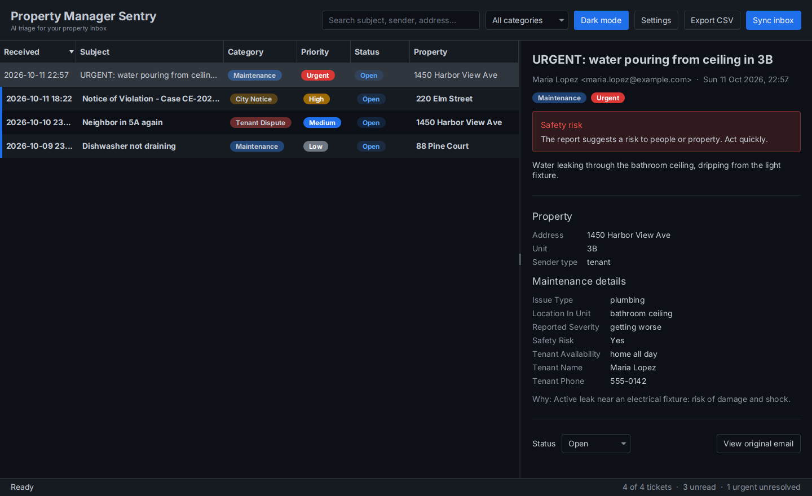

# Property Manager Sentry

A desktop app that reads a property manager's Gmail inbox and uses Gemini to turn each email into a ticket:
**maintenance requests**, **city notices** and **tenant disputes**, with priority and the key details already extracted.
Newsletters, alerts and spam are recognized and skipped.

This is a from-scratch Java rewrite of the Python *Estate Beacon / Inbox Supervisor* app, built to learn how
**Java 25, Spring Boot 4, Spring AI 2 and LangGraph4j** fit together, and to fix the original's weak spots along the way
(see [docs/python-to-java.md](docs/python-to-java.md)).

📘 **Learning agentic AI?** [docs/agentic-ai-guide.md](docs/agentic-ai-guide.md) explains multi-agent concepts
(agents, structured output, shared state, graphs, supervisor/router, handoff, guardrails) using this codebase.
Test emails are in [docs/sample-emails.md](docs/sample-emails.md).



## Tech stack

| Concern | Technology |
|---|---|
| Language | Java 25 (records, sealed interfaces, pattern matching, virtual threads) |
| Application framework | Spring Boot 4.1 (DI, configuration properties, events, scheduling) |
| LLM access | Spring AI 2.0 `ChatClient` with Google Gemini and native structured output |
| Agent workflow | LangGraph4j 1.9 `StateGraph` (supervisor plus specialist nodes) |
| Mail | Gmail API Java client, OAuth2 installed-app flow, Gmail labels for sync state |
| Persistence | H2 file database, Spring Data JPA (Hibernate 7), Flyway migrations |
| UI | JavaFX 25 with the AtlantaFX Primer theme (dark and light) |
| Build | Gradle 9 (Kotlin DSL, version catalog, toolchains) |

## How it works

```
                      ┌──────────────── LangGraph4j StateGraph ────────────────┐
 Gmail ──▶ InboxSync ─┤  supervisor ──┬──▶ maintenance ──┐                     │
 (OAuth2,   Service   │   (route)     ├──▶ cityNotice  ──┼──▶ END              │──▶ TicketService ──▶ H2
  labels)    │        │               ├──▶ dispute     ──┘                     │       │
             │        │               └──▶ END (IGNORED)                       │       │
             │        └────────────── each node = one Gemini call via Spring AI┘       │
             │                                                                         ▼
             └──── SyncEvents (Spring events) ─────────────────────────────▶ JavaFX dashboard
```

1. **`InboxSyncService`** lists unread messages (Gmail query and cap are configurable), drops the ones already
   processed, and triages the rest **in parallel on virtual threads**, with a semaphore limiting concurrent LLM calls.
2. **`TriageGraph`** runs each email through a LangGraph4j graph. The **supervisor** node classifies it and sets the
   priority; a conditional edge sends it to the matching **specialist** node, which extracts the category's details.
3. Each node calls Gemini through Spring AI's `ChatClient` and gets a **Java record** back (`.entity(Record.class)`).
   With native structured output, Spring AI turns the record into a JSON schema, so Gemini has to answer in that shape.
4. **`TicketService`** stores the ticket and a "processed" marker **in one transaction**. Ignored emails get only the
   marker. Failed ones get nothing, so they are retried on the next sync.
5. The email is then **labeled in Gmail**: `Sentry/Processed` on everything triaged, plus `Sentry/Maintenance`,
   `Sentry/City Notice` or `Sentry/Tenant Dispute` on tickets. The search query excludes `Sentry/Processed`, so the
   next sync only lists mail the app hasn't seen. You can also browse the categories from Gmail itself.
6. Progress is published as **Spring application events**; the JavaFX window listens and updates live.

## Getting started

### 1. Prerequisites

- **JDK 25**. If it's missing, Gradle downloads one automatically (foojay toolchain resolver).
- A **Gemini API key** from [Google AI Studio](https://aistudio.google.com/apikey).
- A **Google Cloud OAuth client** for Gmail (needed only for real syncing, not for the demo):
  1. In [Google Cloud Console](https://console.cloud.google.com/), create a project and enable the **Gmail API**.
  2. Configure the OAuth consent screen and add your Gmail address as a test user.
  3. Create credentials: **OAuth client ID**, type **Desktop app**, and download the JSON.

### 2. Try the UI with demo data (no keys needed)

```bash
GOOGLE_API_KEY=dummy ./gradlew bootRun --args='--spring.profiles.active=demo'
```

This seeds four sample tickets so you can click around. "Sync inbox" will tell you Gmail isn't set up yet.
Demo data goes into the same database as real data, so use a throwaway data dir if you want to keep them apart:
`--args='--spring.profiles.active=demo --sentry.data-dir=/tmp/sentry-demo'`.

### 3. Configure for real use

Everything personal lives in `~/.property-manager-sentry/`:

```
~/.property-manager-sentry/
├── application.yml     # your settings (copy config/application.example.yml)
├── credentials.json    # the OAuth client JSON from Google Cloud Console
├── tokens/             # Gmail refresh token (created on first sync)
├── sentry.mv.db        # H2 database (created automatically)
└── logs/sentry.log
```

```bash
mkdir -p ~/.property-manager-sentry
cp config/application.example.yml ~/.property-manager-sentry/application.yml   # then put your API key in it
cp ~/Downloads/client_secret_*.json ~/.property-manager-sentry/credentials.json
./gradlew bootRun
```

#### Alternative: keep everything in the project folder

Spring Boot also reads `config/application.yml` from the folder the app is started in, so you can keep all your
files next to the code instead of in your home folder. Both `config/application.yml` and `data/` are in
`.gitignore`, so your key and Gmail credentials can't be committed by accident.

```bash
cp config/application.example.yml config/application.yml   # API key goes here
mkdir -p data
cp ~/Downloads/client_secret_*.json data/credentials.json
```

Add this to `config/application.yml` so the database, Gmail token and logs go to `data/` too:

```yaml
sentry:
  data-dir: ${user.dir}/data
```

Then start the app from the project folder (`./gradlew bootRun` always does). To keep only the Gmail client file
elsewhere, set `sentry.gmail.credentials-file` to any path instead.

The first **Sync inbox** opens your browser to grant Gmail access. With labels on (the default) Google asks for
permission to "read, compose and send emails" (the `gmail.modify` scope, which has no narrower labels-only variant).
The app only ever adds its own `Sentry/*` labels: it never marks mail read, moves, deletes or sends anything.
Google shows an "unverified app" warning for your own OAuth client; that's expected for a personal test-mode app.

### 4. Build a runnable jar

```bash
./gradlew bootJar
java --enable-native-access=ALL-UNNAMED -jar build/libs/property-manager-sentry-0.1.0-SNAPSHOT.jar
```

The jar contains the JavaFX native libraries for the OS it was built on. Build on the OS you'll run it on.

## Configuration reference

| Property | Default | Meaning |
|---|---|---|
| `spring.ai.google.genai.api-key` | `$GOOGLE_API_KEY` | Gemini API key |
| `spring.ai.google.genai.chat.model` | `gemini-2.5-flash` | Gemini model |
| `sentry.gmail.query` | `in:inbox is:unread` | Gmail search selecting emails to triage |
| `sentry.gmail.max-messages` | `50` | Cap per sync, so a big backlog can't trigger hundreds of LLM calls |
| `sentry.gmail.labels.enabled` | `true` | Label triaged emails and skip labeled ones; `false` keeps the app read-only |
| `sentry.gmail.labels.prefix` | `Sentry` | Parent label name |
| `sentry.triage.concurrency` | `2` | Emails triaged in parallel |
| `sentry.triage.max-body-chars` | `20000` | Longer bodies are truncated before reaching the LLM |
| `sentry.triage.timeout` | `90s` | Per-email time limit |
| `sentry.data-dir` | `~/.property-manager-sentry` | Where the database, tokens and logs live |

The auto-sync interval and theme are set in the app (**Settings**, **Dark mode**) and stored with `java.util.prefs`.

## Project layout

```
src/main/java/com/propertymanager/sentry/
├── SentryLauncher.java        # main(): launches JavaFX
├── SentryApplication.java     # @SpringBootApplication
├── config/                    # SentryProperties (typed config), UserPreferences, Clock bean
├── mail/                      # MailboxClient interface, Gmail implementation, MIME → text
├── triage/                    # LangGraph4j graph, Gemini agents, domain records, prompt sanitizing
├── ticket/                    # JPA entities, repositories, TicketService, CSV export
├── inbox/                     # InboxSyncService (virtual threads), SyncEvents, AutoSyncScheduler
├── demo/                      # sample data for the "demo" profile
└── ui/                        # JavaFX: application, main window, detail pane, dialogs
src/main/resources/
├── application.yml            # defaults
├── db/migration/              # Flyway SQL migrations
├── prompts/*.st               # prompt templates (system prompt + one per node)
└── ui/sentry.css              # styles on top of AtlantaFX
```

## Tests

```bash
./gradlew test
```

- `TriageGraphTest` exercises the LangGraph4j routing with fake agents (no LLM).
- `GeminiTriageAgentsTest` checks prompt rendering and structured-output mapping with a stub `ChatModel`.
- `InboxSyncServiceIT` boots the full Spring context (Flyway, JPA on in-memory H2, the real graph) with a fake
  mailbox and fake agents, and covers de-duplication, labeling, retries, persistence and events.
- `GmailMailboxClientTest` runs the real Gmail client against a fake HTTP transport to check the query, label
  creation and `batchModify` calls.
- Unit tests cover MIME/HTML extraction, prompt-injection guarding and CSV escaping.

No test needs network access, a Gemini key or a display. CI runs `./gradlew build` on every push and pull request.

## Code formatting

Formatting is enforced with [Spotless](https://github.com/diffplug/spotless): Java with google-java-format (AOSP
style, 4-space indent), Gradle Kotlin scripts with ktlint, and trailing whitespace / final newlines for Markdown,
YAML, SQL, CSS and prompt files.

```bash
./gradlew spotlessApply   # reformat everything
./gradlew spotlessCheck   # verify only (also runs as part of ./gradlew build, so CI fails on unformatted code)
```

Wrap a block in `// spotless:off` and `// spotless:on` to keep hand formatting (used for the triage graph
definition in `TriageGraph`). To format on save in IntelliJ, install the google-java-format plugin and enable
AOSP style.

## Notes

- JavaFX runs from the classpath, not as modules, which keeps Spring Boot packaging simple. JavaFX logs a harmless
  `Unsupported JavaFX configuration: classes were loaded from 'unnamed module'` warning at startup because of this.
- **Labels vs read-only.** Labeling is best effort: if a label can't be applied (e.g. you unticked the permission on
  the consent screen), the email is still de-duplicated by the local `processed_email` table and gets labeled on a
  later sync. Set `sentry.gmail.labels.enabled: false` to run with the `gmail.readonly` scope only. Each scope keeps
  its own stored token in `tokens/`, so switching asks for consent once.
